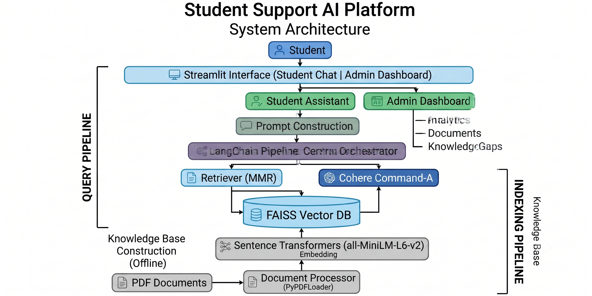
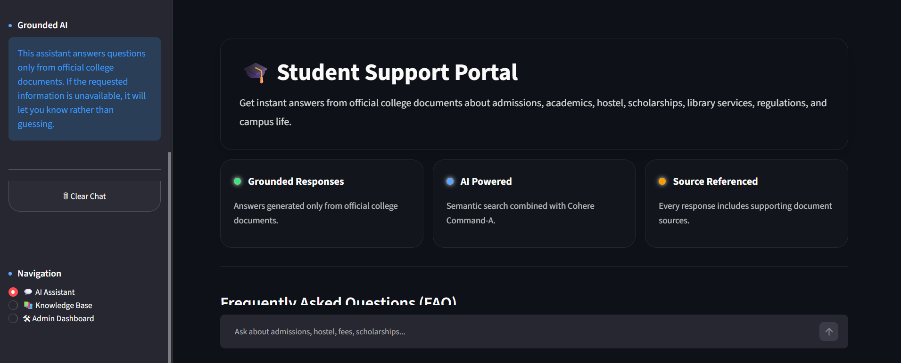
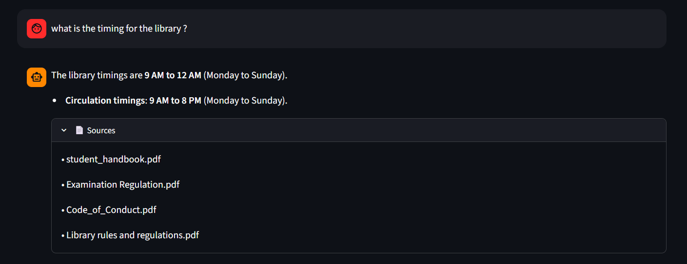
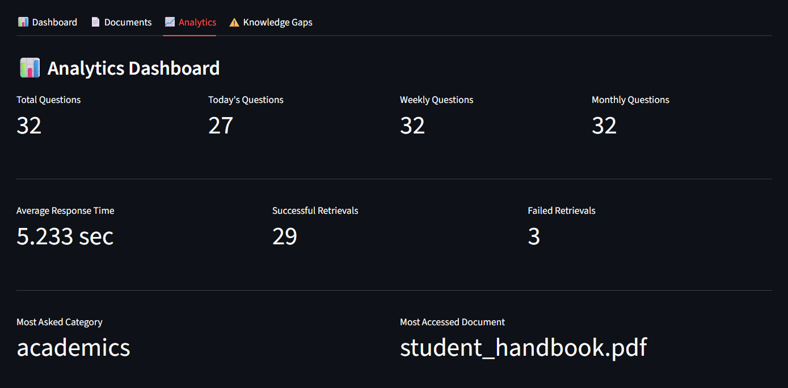
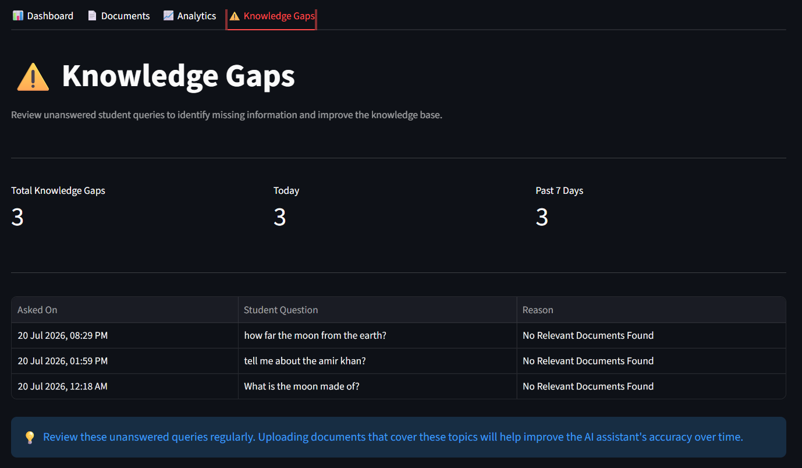

# 🎓 Student Support AI Platform
An AI-powered Retrieval-Augmented Generation (RAG) platform that enables students to query institutional information from official PDF documents using natural language while providing administrators with document management, analytics, and knowledge gap insights.

---


----
## 📑 Table of Contents

- [Overview](#overview)
- [Live Demo](#live-demo)
- [Features](#features)
- [Technology Stack](#technology-stack)
- [System Architecture](#system-architecture)
- [RAG Workflow](#rag-workflow)
- [Project Structure](#project-structure)
- [Getting Started](#getting-started)
- [Deployment](#deployment)
- [Future Scope](#future-scope)
- [Author](#author)

----


## 📖 Overview

Student Support AI Platform is an AI-powered question-answering system designed to help students quickly access institution-specific information.

Instead of manually searching through multiple PDF documents, students can ask questions in natural language and receive responses grounded in official institutional documents using a Retrieval-Augmented Generation (RAG) pipeline.

The platform also provides an administrative interface for managing the knowledge base, monitoring usage analytics, and identifying knowledge gaps to continuously improve the quality of responses.


-----

## 🚀 Live Demo

Try the live application here:

🔗 **Live App:** https://your-streamlit-app.streamlit.app

> **Note**
> The application uses Retrieval-Augmented Generation (RAG) to answer questions from the uploaded institutional documents. Response quality depends on the available knowledge base.

-----

## ✨ Features

### 🤖 AI Assistant
- Natural language question answering
- Retrieval-Augmented Generation (RAG)
- Context-aware responses from institutional documents
- Source document citations

### 📚 Knowledge Management
- PDF upload and indexing
- Automatic text chunking
- Semantic embedding generation
- FAISS vector search

### 📊 Admin Dashboard
- Document management
- Usage analytics
- Knowledge gap detection
- System health overview

### ⚙️ System
- Modular architecture
- JSON interaction logging
- Configurable knowledge base
- Responsive Streamlit Interface

----

## 🛠 Technology Stack

| Category | Technology |
|-----------|------------|
| Programming Language | Python 3.11|
| Frontend | Streamlit |
| Framework | LangChain |
| LLM | Cohere Command-A |
| Embeddings | Sentence Transformers (all-MiniLM-L6-v2) |
| Vector Store | FAISS |
| Retrieval | Maximum Marginal Relevance (MMR) |
| Document Loader | PyPDFLoader |
| Logging | JSON |

----
## 🏗 System Architecture

The platform follows a modular Retrieval-Augmented Generation (RAG) architecture.

<p align="center">
    
</p>

The application separates document processing, retrieval, prompting, and administration into independent modules, making the system easier to maintain and extend.
----

## 📸 Screenshots

### Home Page

<p align="center">
  
</p>

### AI Assistant

<p align="center">
  
</p>

### Analytics Dashboard

<p align="center">
  
</p>

### Knowledge Gaps

<p align="center">
  
</p>

----

## 🔄 RAG Workflow

1. **Document Processing**
   - Upload institutional PDF documents.
   - Extract and clean text.
   - Split content into manageable chunks.

2. **Embedding Generation**
   - Convert text chunks into vector embeddings using **all-MiniLM-L6-v2**.

3. **Vector Storage**
   - Store embeddings in a **FAISS** vector database for efficient semantic retrieval.

4. **User Query**
   - The user submits a question through the Streamlit interface.

5. **Semantic Retrieval**
   - The query is embedded and matched against the most relevant document chunks in FAISS.

6. **Response Generation**
   - Retrieved context is combined with the user's question and sent to the **Cohere Chat** model.

7. **Grounded Answer**
   - The AI generates a response based only on the retrieved institutional information, helping reduce hallucinations.

----

## 📂 Project Structure

```text
Student-Support-AI/
│
├── app.py
├── assets/
├── config/
├── core/
│   ├── document_processor.py
│   ├── faiss_manager.py
│   ├── logger.py
│   └── prompt.py
│
├── modules/
│   ├── assistant/
│   ├── admin/
│   └── knowledge_base/
│
├── data/
├── logs/
├── requirements.txt
└── README.md
```

----


## 🚀 Getting Started

### Prerequisites

- Python 3.11 or later
- Cohere API Key

### Installation

1. Clone the repository

```bash
git clone https://github.com/achal-shukla/Student-Support-AI-Platform.git
cd Student-Support-AI-Platform
```

2. Create a virtual environment

```bash
python -m venv .venv
```

**Windows**

```bash
.venv\Scripts\activate
```

**Linux / macOS**

```bash
source .venv/bin/activate
```

3. Install dependencies

```bash
pip install -r requirements.txt
```

4. Configure your Cohere API key

Create a `.streamlit/secrets.toml` file:

```toml
COHERE_API_KEY="your_api_key_here"
```

5. Start the application

```bash
streamlit run app.py
```

## 🌐 Deployment

The application is deployed using **Streamlit Community Cloud**.

### Deployment Steps

1. Push the project to GitHub.
2. Create a new app on Streamlit Community Cloud.
3. Connect the GitHub repository.
4. Add the `COHERE_API_KEY` under **Secrets**.
5. Deploy the application.

The live demo is available in the **Live Demo** section above.

---

## 🔮 Future Scope

Future enhancements planned for the platform include:

- User authentication and role-based access
- Chat history and conversation management
- Hybrid retrieval (Keyword + Semantic Search)
- Re-ranking for improved retrieval accuracy
- Database-backed logging and analytics
- Multi-language document support
- Feedback-driven knowledge base improvement
- Docker containerization and CI/CD pipeline

---

## 👨‍💻 Author

**Achal Shukla**

- GitHub: https://github.com/<your-username>
- LinkedIn: https://linkedin.com/in/<your-profile>

If you found this project helpful, consider giving it a ⭐ on GitHub.

---

